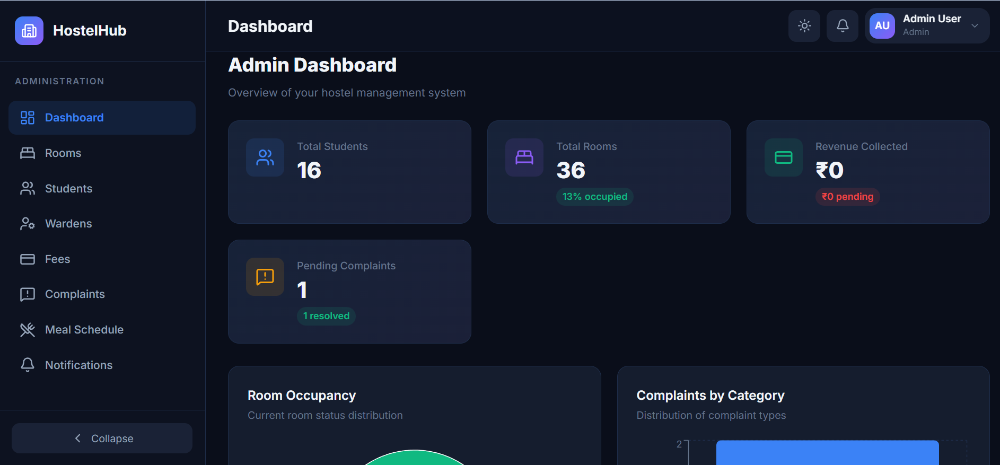
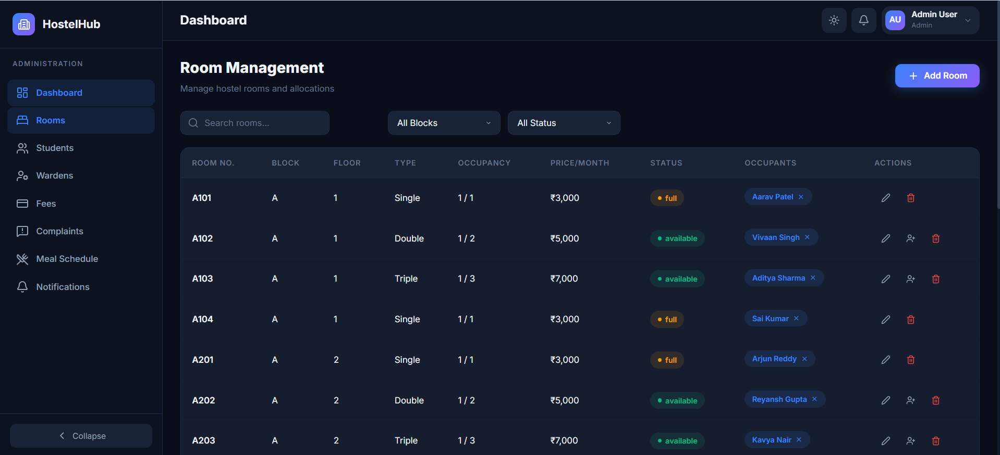
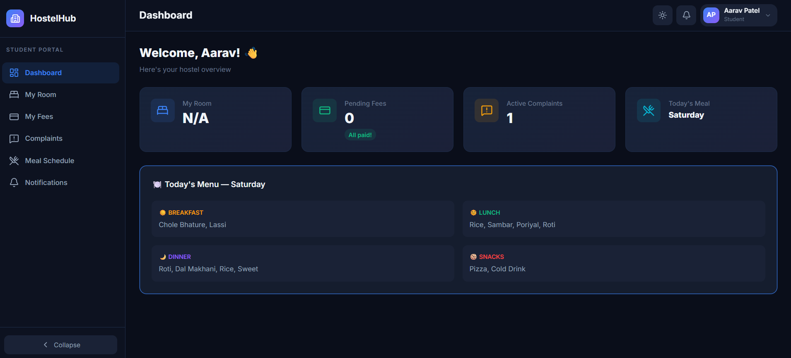
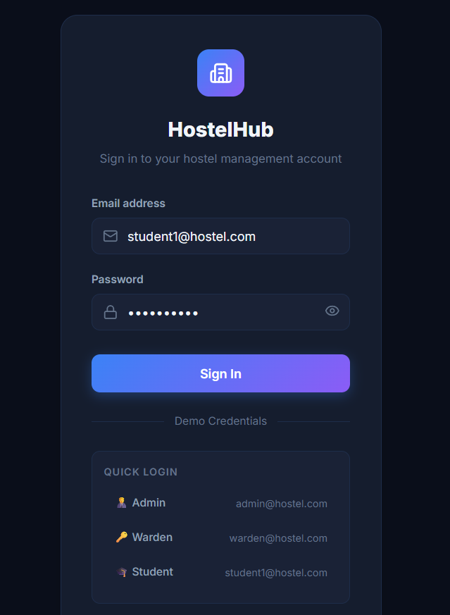

# 🏨 HostelHub — Modern Role-Based Hostel Management System

[](https://hostel-management-system-black-two.vercel.app/)
[](https://hostel-management-system-nip3.onrender.com/api/health)
[](https://www.mongodb.com/cloud/atlas)
[](https://react.dev/)
[](https://nodejs.org/)
[](https://opensource.org/licenses/MIT)

> **A full-stack, role-based Hostel Management System engineered to digitize accommodation administration, automate room allocations, monitor fee dues, and resolve resident complaints.**

Developed by **[Nishant Patle](https://github.com/NishantPatle06)**.

---

## 🌐 Live Deployments & Demo

| Component | Platform | Live URL | Status |
|---|---|---|---|
| 🖥️ **Web Application** | **Vercel** | [**hostel-management-system-black-two.vercel.app**](https://hostel-management-system-black-two.vercel.app/) |  |
| ⚙️ **REST API Server** | **Render** | [**hostel-management-system-nip3.onrender.com/api/health**](https://hostel-management-system-nip3.onrender.com/api/health) |  |
| 🗄️ **Database Cluster** | **MongoDB Atlas** | Cloud M0 Shared Cluster |  |

### 🔑 Test Credentials (One-Click Demo Available on Login)

| Role | Email | Password | Access & Responsibilities |
|---|---|---|---|
| 👑 **Admin** | `admin@hostel.com` | `admin123` | Master dashboard, Room grid allocation, Student & Staff management, Financial overview |
| 🛡️ **Warden** | `warden@hostel.com` | `warden123` | Complaint resolution board, Weekly meal planner, Student records |
| 🎓 **Student** | `student1@hostel.com` | `student123` | Personalized room details, Fee payment status, Maintenance complaint filing |

---

## 📸 Interface Preview

| 👑 **Admin Analytics Dashboard** | 🏢 **Visual Room Allocation Grid** |
|:---:|:---:|
|  |  |
| *Real-time occupancy charts, revenue & complaint stats* | *Interactive bed grid with live vacancy status* |

| 🎓 **Student Resident Portal** | 🔐 **Secure Authentication** |
|:---:|:---:|
|  |  |
| *Personalized view for room, fees & maintenance* | *JWT authenticated login with role redirection* |

---

## ✨ Key Features

### 👑 Administrator Control Center
- **Dynamic Analytics Dashboard**: Interactive charts tracking occupancy rates, fee revenues, and complaint resolution timelines powered by **Recharts**.
- **Visual Room & Bed Allocation**: Live color-coded room grid (Available, Partial, Occupied) with automated vacancy tracking across blocks.
- **Student & Staff Directory**: Complete CRUD lifecycle for student enrollments and warden assignments.
- **Financial Tracking**: Fee status oversight across pending, paid, and overdue balances.

### 🛡️ Warden Operations Panel
- **Complaint Ticket Management**: Filter, prioritize, and update student complaint states (`Pending` ➔ `In Progress` ➔ `Resolved`).
- **Mess & Dietary Scheduling**: Create and publish weekly 4-meal schedules (Breakfast, Lunch, Snacks, Dinner).
- **Broadcast Announcements**: Send critical hostel notices and curfew updates to all residents.

### 🎓 Student Self-Service Portal
- **Profile & Room Details**: Instant access to assigned room number, block, and bed assignment.
- **Fee Records**: Track payment history and upcoming installment dates.
- **Maintenance Ticketing**: Submit categorized complaints (Electrical, Plumbing, WiFi, Hygiene) with priority flags and status tracking.

---

## 🛠️ Tech Stack & Architecture

- **Frontend**: React 19, Vite, React Router v7, Framer Motion, Recharts, Lucide Icons, React Hot Toast
- **Backend**: Node.js, Express.js (v5), MVC Architecture, Cookie-Parser, CORS
- **Database**: MongoDB Atlas (Production) / Mongoose v9 / `mongodb-memory-server` (Zero-config local fallback)
- **Security**: JWT (JSON Web Tokens), Role-Based Access Control (RBAC), bcryptjs password hashing
- **Deployment**: Vercel (Frontend CI/CD), Render (Backend Web Service), MongoDB Atlas (Cloud Cluster)

---

## 📂 Project Architecture

```bash
hostel-management-system/
├── client/                     # Frontend Application (React 19 + Vite)
│   ├── src/
│   │   ├── components/         # Shared layouts, Navbar, Sidebar, Route Guards
│   │   ├── contexts/           # Global AuthContext & ThemeContext
│   │   ├── pages/
│   │   │   ├── admin/          # Admin Dashboard, Room Grid, Student Management
│   │   │   ├── auth/           # Login & Register views
│   │   │   ├── shared/         # Complaints, Fees, Meal Planner, Notifications
│   │   │   ├── student/        # Student Portal & Room view
│   │   │   └── warden/         # Warden operational views
│   │   ├── services/           # Axios API Client & Route Services
│   │   └── App.jsx             # RBAC Routing & Toaster Config
│   └── vercel.json             # Vercel Single-Page App Rewrites
│
└── server/                     # Backend Application (Node.js + Express.js)
    ├── config/                 # MongoDB Atlas & In-Memory DB connection
    ├── controllers/            # Controller business logic
    ├── middleware/             # JWT auth & RBAC route authorization
    ├── models/                 # Mongoose Schemas (User, Room, Complaint, Fee, Meal)
    ├── routes/                 # Express API Endpoints
    ├── utils/                  # Database Seed script for instant demo data
    └── server.js               # Express application entry point
```

---

## 🔧 Local Development Setup

### 1. Clone the repository
```bash
git clone https://github.com/NishantPatle06/hostel-management-system..git
cd hostel-management-system
```

### 2. Backend Setup
```bash
cd server
npm install
```

Create a `.env` file in `server/`:
```env
PORT=5000
NODE_ENV=development
CLIENT_URL=http://localhost:5173
JWT_SECRET=your_jwt_secret_key_here
MONGO_URI=mongodb+srv://<username>:<password>@cluster0.mongodb.net/hostel-db
```
*(Note: If `MONGO_URI` is omitted, the server automatically starts an in-memory database with preloaded demo data!)*

Start backend server:
```bash
npm run dev
```

### 3. Frontend Setup
In a new terminal window:
```bash
cd client
npm install
npm run dev
```
Open **[http://localhost:5173](http://localhost:5173)** in your browser!

---

## 📡 REST API Reference

| Method | Endpoint | Description | Access |
|---|---|---|---|
| `POST` | `/api/auth/login` | Authenticate & issue JWT | Public |
| `POST` | `/api/auth/register` | Register new student resident | Public |
| `GET` | `/api/dashboard/stats` | High-level analytics & metrics | Admin |
| `GET` | `/api/rooms` | Retrieve all rooms & vacancies | Admin / Warden / Student |
| `PUT` | `/api/rooms/:id/allocate` | Allocate bed to student | Admin / Warden |
| `GET` | `/api/complaints` | Fetch maintenance complaints | Admin / Warden / Student |
| `POST` | `/api/complaints` | File a new complaint ticket | Student |
| `PUT` | `/api/complaints/:id` | Update complaint status | Admin / Warden |
| `GET` | `/api/meals` | Retrieve weekly mess schedule | Authenticated |
| `GET` | `/api/fees` | View fee dues and transaction log | Admin / Student |
| `GET` | `/api/health` | Service health check | Public |

---

## 👨‍💻 Author

**Nishant Patle**
- **GitHub:** [@NishantPatle06](https://github.com/NishantPatle06)
- **Institution:** Indian Institute of Information Technology, Una (IIIT Una)
- **Email:** 23235@iiitu.ac.in

---

## 📄 License

This project is licensed under the [MIT License](LICENSE).
